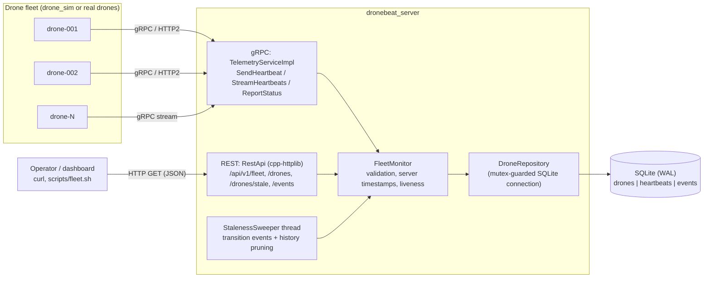

# DroneBeat

**A gRPC heartbeat monitor for drone fleets, written in C++17.**

Drones send heartbeats (position, battery, flight mode) and status updates to DroneBeat over
gRPC. DroneBeat stores each drone's latest state and its recent history in SQLite. A REST/JSON
API lets you check on the fleet and lists **stale** drones, meaning ones the server hasn't
heard from recently. The repo also includes a mock fleet simulator (`drone_sim`). It flies
virtual drones, drops their radio links at random and crashes some of them, so you can watch
the stale-node detection work.

## Features

- **gRPC ingest:** unary `SendHeartbeat`, client-streaming `StreamHeartbeats`, and
  `ReportStatus` for faults and other events.
- **Liveness tracking:** each drone is classified as `ALIVE`, `STALE` or `LOST` using the
  **server's receive time**, because drone clocks can be wrong. Both thresholds can be
  configured.
- **Staleness sweeper:** a background thread that records a `LINK_STALE`, `LINK_LOST` or
  `LINK_RECOVERED` event whenever a drone moves between states. It also prunes old history.
- **SQLite persistence:** WAL mode and versioned migrations. Each heartbeat updates the
  drone's state row and adds a history row in a single transaction. Duplicate heartbeats with
  the same sequence number are ignored.
- **REST API:** fleet summary, drone list with a liveness filter, single-drone lookup,
  history, stale list and event log.
- **Simulator:** each drone is a thread running a flight/battery model. Drones take off, fly a
  mission, return home when the battery is low and land. The simulator also produces link
  drops and permanent crashes.

## Architecture



### Liveness rules

| State   | Condition (`age = now - last_seen`) | Default    |
|---------|-------------------------------------|------------|
| `ALIVE` | `age <= stale_after_ms`             | ≤ 5 s      |
| `STALE` | `stale_after_ms < age <= lost_after_ms` | 5 s – 30 s |
| `LOST`  | `age > lost_after_ms`               | > 30 s     |

### Code layout

```
proto/dronebeat.proto        gRPC service + messages
src/core/                    domain types, Clock abstraction, liveness classifier
src/config/                  server config (defaults < DRONEBEAT_* env < CLI flags)
src/storage/                 SQLite RAII wrappers, migrations, DroneRepository
src/service/                 FleetMonitor facade, StalenessSweeper
src/rpc/                     gRPC service + proto<->domain conversion
src/rest/                    REST routes + JSON serialization
src/server/main.cpp          dronebeat_server entrypoint
src/sim/                     drone_sim: flight model, CLI, fleet runner
tests/                       GoogleTest suites (core, storage, monitor, rpc, rest, sim)
scripts/                     fleet.sh (REST helper), send_heartbeat.sh (grpcurl)
```

## Requirements

- A C++17 compiler (GCC 9+ or Clang 10+) and CMake 3.20 or newer
- gRPC and Protobuf development packages, including `protoc` and `grpc_cpp_plugin`
- SQLite3 development headers
- Internet access the first time you configure the build. CMake fetches cpp-httplib,
  nlohmann/json and GoogleTest with `FetchContent`.

No hardware or credentials are needed. The service has no authentication, so run it only on
a trusted network.

To install the dependencies:

```bash
# macOS
brew install cmake grpc protobuf sqlite

# Ubuntu 24.04
sudo apt install build-essential cmake libgrpc++-dev libprotobuf-dev \
     protobuf-compiler protobuf-compiler-grpc libsqlite3-dev
```

## How to run

### Build

```bash
cmake -S . -B build -DCMAKE_BUILD_TYPE=Release
cmake --build build -j
```

### Start the server

```bash
./build/src/dronebeat_server --db dronebeat.db --stale-after-ms 5000 --lost-after-ms 30000
```

Every flag can also be set with an environment variable. The full list is in
`.env.example`, and `--help` prints them too.

| Flag                      | Env var                          | Default         |
|---------------------------|----------------------------------|-----------------|
| `--grpc-address`          | `DRONEBEAT_GRPC_ADDRESS`         | `0.0.0.0:50051` |
| `--rest-host`             | `DRONEBEAT_REST_HOST`            | `0.0.0.0`       |
| `--rest-port`             | `DRONEBEAT_REST_PORT`            | `8080`          |
| `--db`                    | `DRONEBEAT_DB_PATH`              | `dronebeat.db`  |
| `--stale-after-ms`        | `DRONEBEAT_STALE_AFTER_MS`       | `5000`          |
| `--lost-after-ms`         | `DRONEBEAT_LOST_AFTER_MS`        | `30000`         |
| `--low-battery-pct`       | `DRONEBEAT_LOW_BATTERY_PCT`      | `20`            |
| `--sweep-interval-ms`     | `DRONEBEAT_SWEEP_INTERVAL_MS`    | `1000`          |
| `--history-retention-ms`  | `DRONEBEAT_HISTORY_RETENTION_MS` | `86400000`      |

### Simulate a fleet

```bash
# 20 drones, 1 Hz, 2% chance per tick of a temporary link drop, 10% eventually crash
./build/src/drone_sim --target localhost:50051 --drones 20 --dropout-prob 0.02

# Use the client-streaming RPC instead of unary calls, with a fixed seed so runs repeat
./build/src/drone_sim --drones 5 --stream --seed 42 --duration-s 120
```

### Query the fleet

```bash
curl -s localhost:8080/api/v1/fleet | jq
curl -s localhost:8080/api/v1/drones/stale | jq
curl -s 'localhost:8080/api/v1/drones?liveness=LOST' | jq
curl -s localhost:8080/api/v1/drones/drone-001 | jq
curl -s 'localhost:8080/api/v1/drones/drone-001/history?limit=10' | jq
curl -s 'localhost:8080/api/v1/events?drone_id=drone-001' | jq

# or use the helper script
scripts/fleet.sh watch
```

Here is an example response from `GET /api/v1/drones/stale`:

```json
{
  "count": 1,
  "stale_after_ms": 5000,
  "drones": [
    {
      "drone_id": "drone-007",
      "liveness": "STALE",
      "silent_for_ms": 12034,
      "last_seen_ms": 1760000000000,
      "mode": "MISSION",
      "battery_pct": 64.2,
      "position": {"latitude": 37.43, "longitude": -122.17, "altitude_m": 120.0},
      "...": "..."
    }
  ]
}
```

To send a single heartbeat by hand (needs [grpcurl](https://github.com/fullstorydev/grpcurl)):

```bash
scripts/send_heartbeat.sh manual-01
```

### Docker

```bash
cp .env.example .env
docker compose up --build        # starts the server and a 20-drone simulator
curl -s localhost:8080/api/v1/fleet
```

### REST reference

| Method | Path                                   | Query params                     |
|--------|----------------------------------------|----------------------------------|
| GET    | `/healthz`                             |                                  |
| GET    | `/api/v1/fleet`                        |                                  |
| GET    | `/api/v1/drones`                       | `liveness=ALIVE\|STALE\|LOST`    |
| GET    | `/api/v1/drones/stale`                 |                                  |
| GET    | `/api/v1/drones/{id}`                  |                                  |
| GET    | `/api/v1/drones/{id}/history`          | `since_ms`, `limit` (≤ 1000)     |
| GET    | `/api/v1/events`                       | `drone_id`, `since_ms`, `limit`  |

Errors come back as JSON in the form `{"error": "...", "status": 4xx}`.

## How to test

The unit tests use GoogleTest and run through CTest:

```bash
cmake -S . -B build -DDRONEBEAT_BUILD_TESTS=ON
cmake --build build -j
ctest --test-dir build --output-on-failure
```

| Suite          | What it covers                                                             |
|----------------|----------------------------------------------------------------------------|
| `core_test`    | liveness thresholds, enum and string round-trips, config/env/flag parsing  |
| `storage_test` | migrations, upserts, duplicate sequences, history order and pruning, events |
| `monitor_test` | validation, server-side timestamps, summary, sweeper transitions (fake clock) |
| `rpc_test`     | gRPC handlers called directly, status codes, proto conversion              |
| `rest_test`    | every REST route against a real in-process HTTP server on a random port    |
| `sim_test`     | simulator model validity, determinism, low-battery return home, CLI parsing |

The tests use a `FakeClock` and in-memory SQLite (`:memory:`), so they're deterministic and
don't need a running server.

To run an end-to-end check by hand: start the server, start `drone_sim --dropout-prob 0.05`,
then run `scripts/fleet.sh watch`. Drones should move through `STALE` and `LOST` and back to
`ALIVE`, and the matching `LINK_*` events should appear under `/api/v1/events`.

## Design notes and limits

- **One SQLite connection behind a mutex.** This easily handles hundreds of drones at 1 Hz.
  Much larger fleets would need batched writes or a separate writer thread with a queue.
- **Liveness is computed when you query, not stored.** API results are always current, and
  the sweeper exists only to record transitions as events.
- **Duplicate detection only compares against the last sequence number.** A drone that
  reboots and starts again from 1 is accepted, but an exact retry is ignored.
